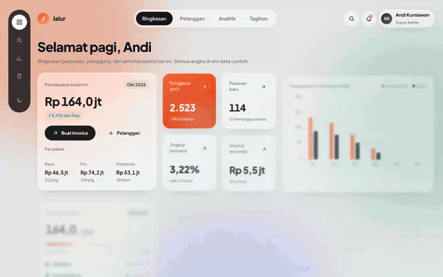
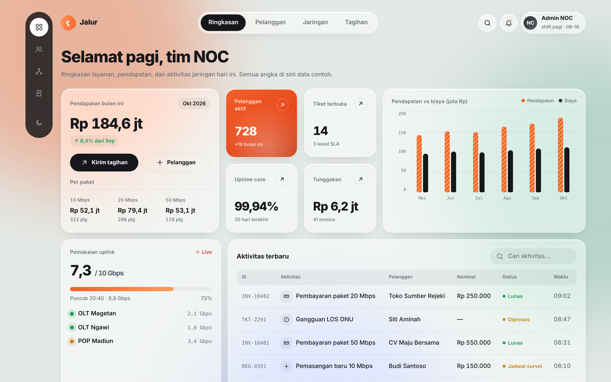
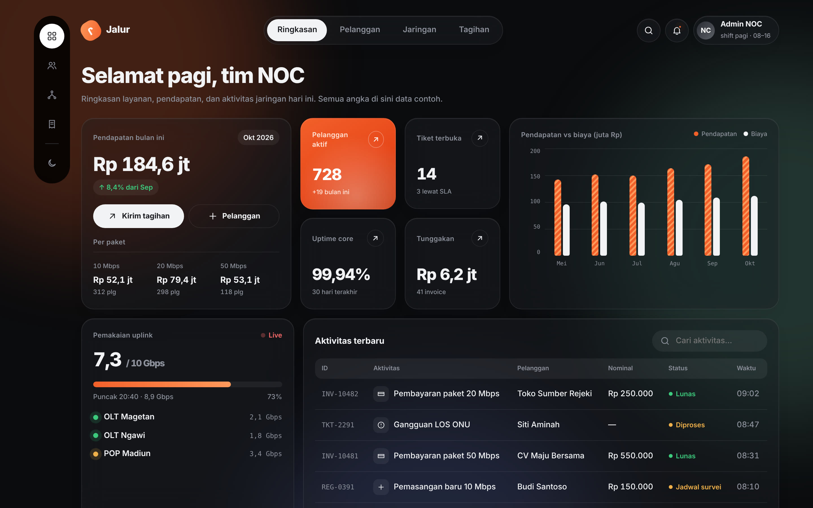
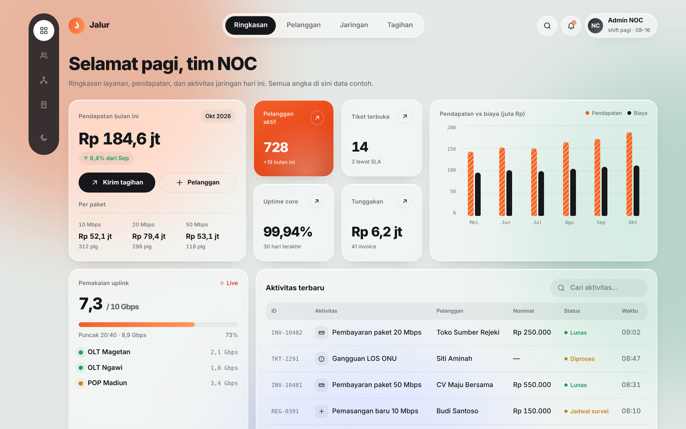
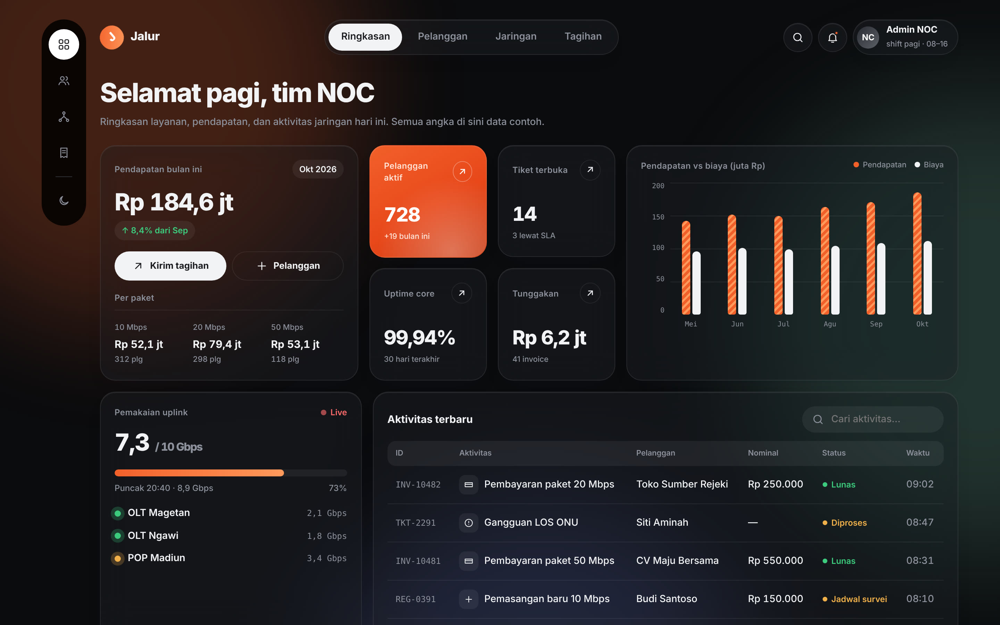
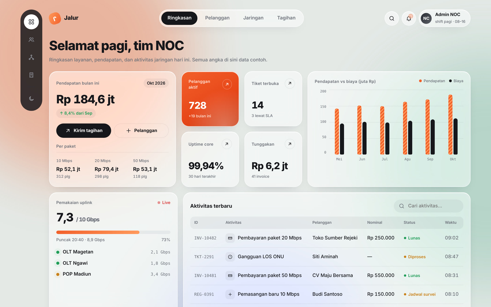
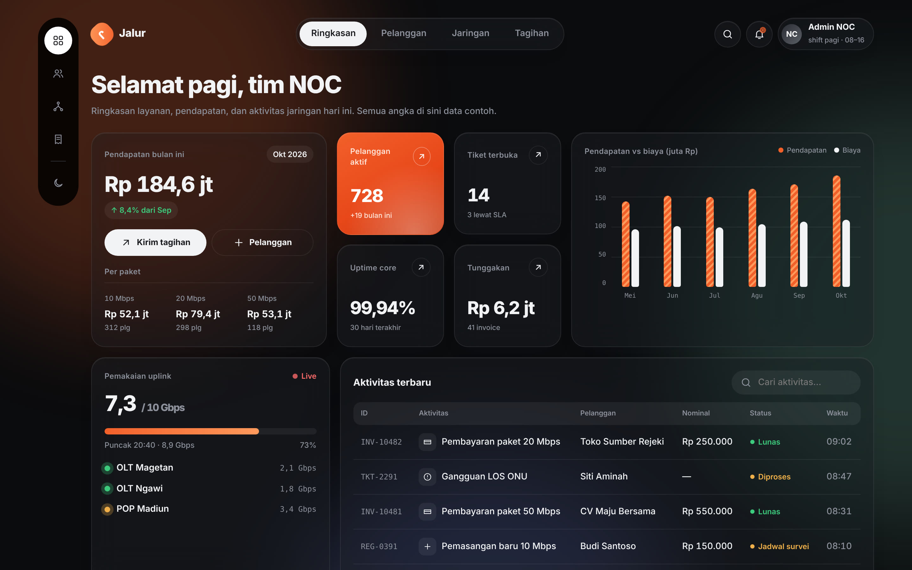
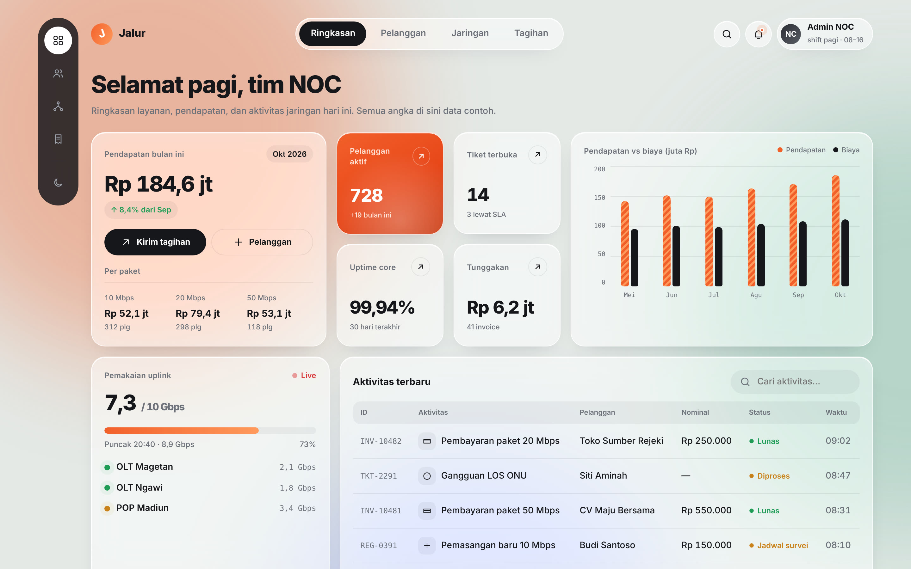
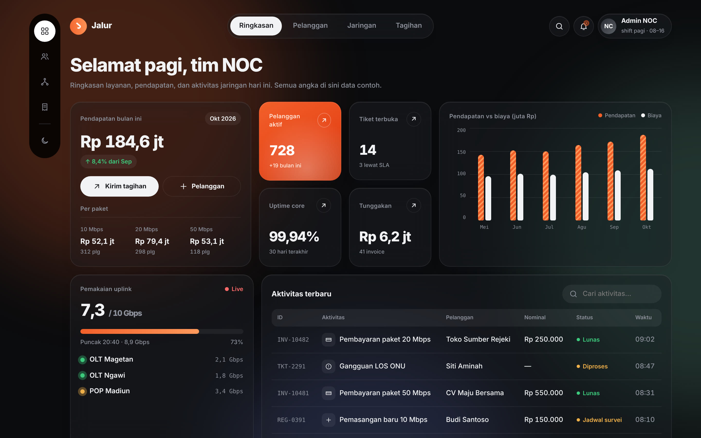
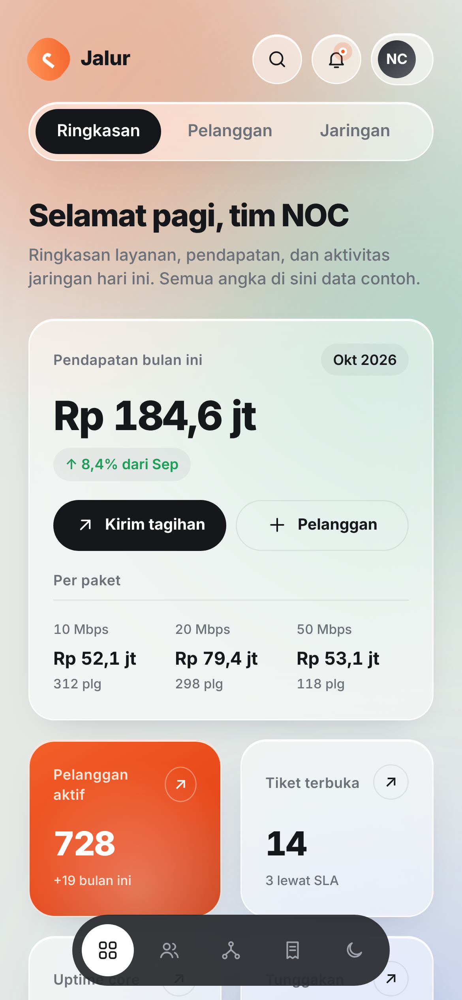

# Jalur — ISP & NOC Dashboard Template

Dashboard premium untuk ISP, RT/RW Net, dan tim NOC. 
Glassmorphism · animasi halus · mode gelap · tanpa framework.

**[▶ Coba Live Demo](LINK-DEMO)** &nbsp;·&nbsp; **[🛒 Beli Source Code](LINK-TOKO)**

<!-- VIDEO: di github.com klik ikon pensil (Edit) pada README ini, lalu seret file media/demo.mp4 ke baris ini.
     GitHub otomatis mengganti dengan link user-attachments yang tampil sebagai pemutar video HD. -->

## Kenapa Jalur?

Kebanyakan template admin terlihat sama. Jalur dibuat khusus untuk dunia ISP: pelanggan PPPoE, ONU, OLT, tiket gangguan, jadwal teknisi, dan penagihan bulanan, dengan tampilan yang terasa seperti produk SaaS kelas atas.

## Fitur

| Animasi & UI | Halaman & Fungsi |
|---|---|
| Transisi sapuan diagonal antar halaman | **Ringkasan**: pendapatan, KPI, grafik, aktivitas |
| Ganti tema efek "venom" yang merambat | **Pelanggan**: profil, tiket, kalender teknisi, pesan |
| Glassmorphism + bola warna melayang | **Jaringan**: trafik live, alarm, daftar perangkat |
| Dock magnify ala macOS | **Tagihan**: progres penagihan, paket, promo, riwayat |
| Indikator pill meluncur | Pencarian aktivitas real-time |
| Angka count-up, grafik tumbuh | Mode terang & gelap |
| Kartu tilt 3D | Responsif sampai HP |
| Tombol spinner → centang | Hormati "kurangi gerakan" |

**Nol dependensi.** HTML, CSS, dan JavaScript murni. Buka `index.html`, langsung jalan. Tidak perlu npm, build, atau framework.

## Tangkapan Layar

| Terang | Gelap |
|---|---|
|  |  |
|  |  |
|  |  |
|  |  |

## Yang Kamu Dapat

- Source code lengkap (`index.html`, `style.css`, `app.js`) yang rapi dan diberi komentar
- Panduan kustomisasi: ganti warna, brand, data, dan menambah halaman
- Titik sambung data live untuk MikroTik, Proxmox, LibreNMS, atau API sendiri
- Lisensi komersial: boleh dipakai di proyek pribadi dan proyek klien
- Update gratis untuk versi berikutnya

## Beli

**[🛒 Beli di LINK-TOKO](LINK-TOKO)**

Butuh versi custom (integrasi RADIUS, MikroTik API, Laravel/Node backend)? Hubungi saya lewat [Instagram/WhatsApp](LINK-KONTAK).

---

© 2026 Ardha Febrian Muqorrobin. Repo ini berisi pratinjau; source code tersedia lewat pembelian. Lihat [LICENSE](LICENSE).
