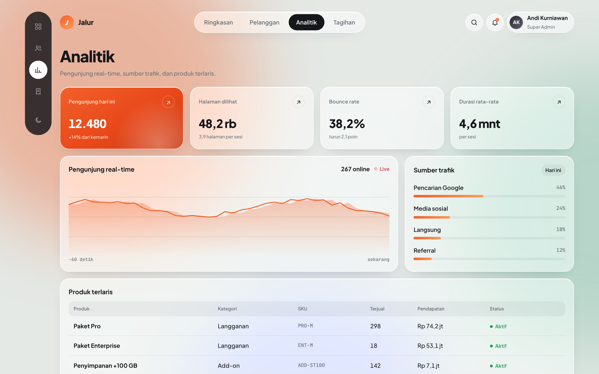
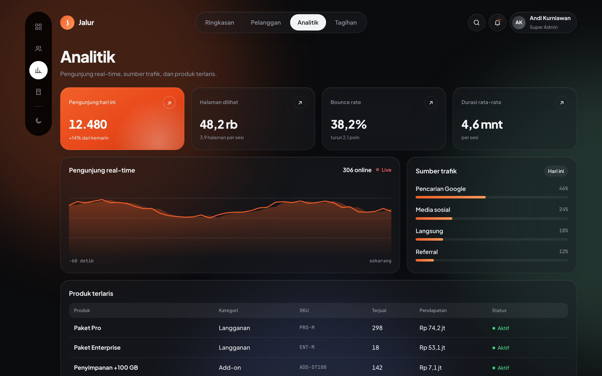

# Jalur — Admin Dashboard Template

Template admin dashboard premium untuk SaaS, toko online, dan aplikasi bisnis. 
Glassmorphism · animasi halus · mode gelap · tanpa framework.

**[▶ Tonton Video Promo](https://asammanis89.github.io/video/jalur-promo.mp4)** &nbsp;·&nbsp; **[💬 Pesan via WhatsApp](https://wa.me/6285755171491?text=Halo%2C%20saya%20tertarik%20template%20Jalur%20Admin%20Dashboard)**

## Kenapa Jalur?

Kebanyakan template admin terlihat sama: sidebar abu-abu, tabel polos, tanpa karakter. Jalur dibuat supaya aplikasi kamu terasa seperti produk SaaS kelas atas sejak hari pertama, tanpa harus belajar framework baru.

## Fitur

| Animasi & UI | Halaman & Fungsi |
|---|---|
| Transisi sapuan diagonal antar halaman | **Ringkasan**: pendapatan, KPI, grafik, aktivitas |
| Ganti tema efek "venom" yang merambat | **Pelanggan**: profil, proyek, kalender tim, pesan |
| Glassmorphism + bola warna melayang | **Analitik**: pengunjung live, sumber trafik, produk terlaris |
| Dock magnify ala macOS | **Tagihan**: progres penagihan, paket, promo, riwayat |
| Indikator pill meluncur | Pencarian aktivitas real-time |
| Angka count-up, grafik tumbuh | Mode terang & gelap |
| Kartu tilt 3D | Responsif sampai HP |
| Tombol spinner → centang | Hormati "kurangi gerakan" |

**Nol dependensi.** HTML, CSS, dan JavaScript murni. Buka `index.html`, langsung jalan. Mudah dipasang ke Laravel, Node.js, PHP, atau backend apa pun.

## Tangkapan Layar

| Terang | Gelap |
|---|---|
|  |  |
|  |  |
|  |  |
|  |  |

## Yang Kamu Dapat

- Source code lengkap (`index.html`, `style.css`, `app.js`) yang rapi dan diberi komentar
- Panduan kustomisasi: ganti warna, brand, data, dan menambah halaman
- Titik sambung data live untuk API atau backend sendiri
- Lisensi komersial: boleh dipakai di proyek pribadi dan proyek klien
- Update gratis untuk versi berikutnya

## Cara Beli

Hubungi langsung lewat WhatsApp: **[0857-5517-1491](https://wa.me/6285755171491?text=Halo%2C%20saya%20tertarik%20template%20Jalur%20Admin%20Dashboard)**

Butuh versi custom, misalnya disambungkan ke backend Laravel atau Node.js? Tanyakan juga lewat WhatsApp.

---

© 2026 Ardha Febrian Muqorrobin · Ardha Web & VPS. Repo ini berisi pratinjau; source code tersedia lewat pembelian. Lihat [LICENSE](LICENSE).
